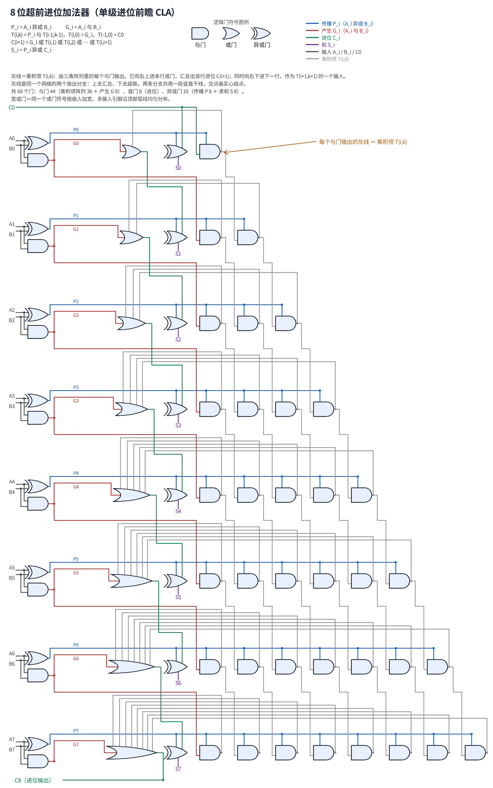
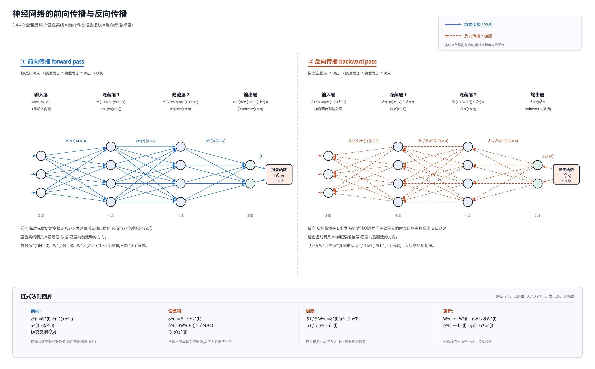

# miko_skill_schematic

DSH 技能:用纯 Python + Pillow 画**白底线框**技术图——电路原理图(逻辑门/数字电路/接线图)
与神经网络示意图(前向传播、反向传播、梯度)。除 Pillow 外无依赖,不碰 matplotlib / cairo。

共享画布底座 + 两个可跑范例 + 风格规范 + 几何/逻辑自检;新图照范例改,不要从零画。

## 预览

8 位超前进位加法器(CLA)门级原理图,1950×3120:



MLP 前向 / 反向传播双栏示意图,2900×1800:



## 安装

技能目录固定为 `~/.dsh/skills/schematic-diagrams`(DSH 从这里发现技能):

```sh
git clone https://github.com/ToyosatomiminoMiko/miko_skill_schematic.git ~/.dsh/skills/schematic-diagrams
```

项目级安装可放到 `<项目>/.dsh/skills/schematic-diagrams`。

依赖:Python 3.8+ 与 Pillow(在 12.3.0 上验证)。中文标签需要系统装有 Noto Sans CJK
(候选路径见 `scripts/canvas.py` 的 `_FONT_CANDIDATES`);找不到会退化到默认字体,
中文会显示成方块,但不会报错。

## 用法

```sh
S=~/.dsh/skills/schematic-diagrams
python3 "$S/scripts/circuit_cla.py"           # 重绘电路范例 -> $S/assets/circuit_cla.png
python3 "$S/scripts/nn_forward_backward.py"   # 重绘神经网络范例 -> $S/assets/nn_forward_backward.png
python3 "$S/scripts/verify.py" all --logic    # 几何 + CLA 逻辑仿真自检
python3 "$S/scripts/circuit_cla.py" out.png   # 指定输出路径
```

`SKILL.md` 是给模型读的完整说明书:快速开始、21 行最小模板、canvas API 速查、工作流、
硬约束与常见坑。风格规范在 `references/`:电路类看 `circuit-style.md`,神经网络类看
`nn-style.md`。

## 仓库内容

| 文件 | 说明 |
| --- | --- |
| `SKILL.md` | 技能说明:快速开始、最小模板、canvas 速查、工作流、硬约束 |
| `scripts/canvas.py` | 画布底座:2× 超采样、门符号、节点/箭头/虚线、中文标注、标题块、图例、PNG 导出 |
| `scripts/circuit_cla.py` | 范例:8 位超前进位加法器门级原理图(通道布线、门队列的完整套路) |
| `scripts/nn_forward_backward.py` | 范例:MLP 前向/反向传播双栏对照图 |
| `scripts/verify.py` | 自检:穿门体/节点、共线短路、断线、文字重叠/出界 + CLA 逻辑仿真 |
| `references/circuit-style.md` | 电路图规范:配色、栅格、门尺寸、布线原则、自检清单 |
| `references/nn-style.md` | 神经网络图规范:两栏版式、节点几何、公式写法 |
| `assets/` | 两张参考成图,改图时先看它们 |

## 自检

`python3 scripts/verify.py all --logic` 必须 **0 严重问题、退出码 0** 才算合格;逻辑仿真
对 8 位 CLA 穷举 131072 组输入并与行波进位模型对拍。文字重叠只算警告,不计入退出码,
但交付前仍应处理。

## 设计要点

- **纯 Pillow**:2 倍分辨率绘制 + LANCZOS 缩小,得到免费的 4× 样本抗锯齿;
  线宽、坐标都按最终像素取整,换机器渲染结果一致。
- **坐标即最终像素**;绘制顺序 = 登记顺序,结点其次、文字最后,门体要压线头就自己延后登记。
- **只出 PNG**:无损,体积约为同图 P6 PPM 的 1/30,仓库里不存中间格式。
- **风格单点**:纸色/墨色/填充/线宽集中在 `canvas.STYLE`;各图语义色留在各自文件开头。
- **复用优先**:公共排版/箭头/图例助手都在 `canvas.py`,范例里不重写。

## 许可

GPL-3.0,见 [LICENSE](LICENSE)。
